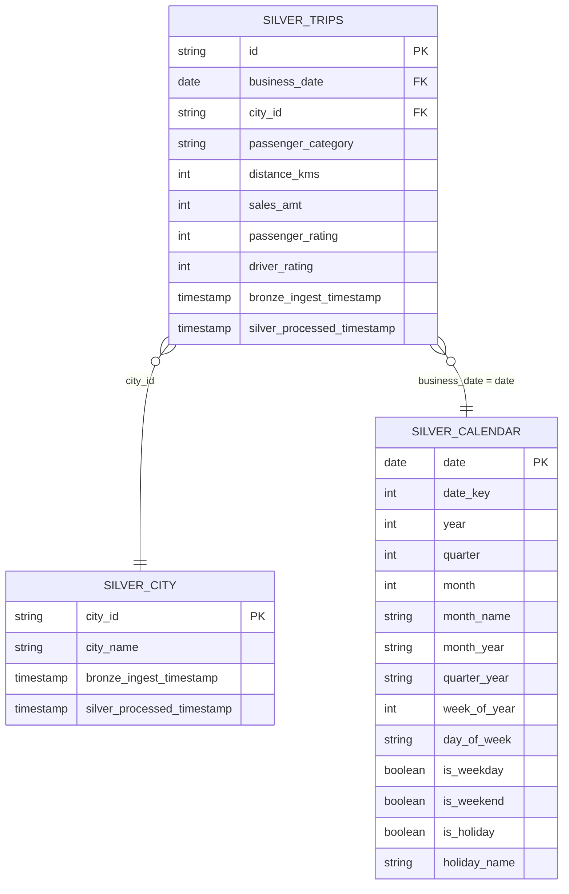
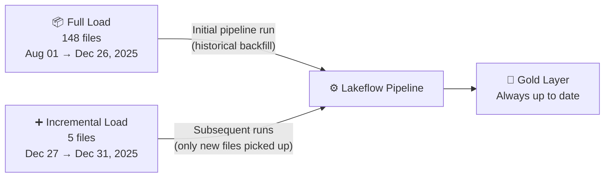

<div align="center">

# 🚖 End-to-End Medallion LakeFlow Transportation ETL & Data Analytics Pipeline

### End-to-End Medallion Lakehouse on Databricks for a Multi-City Ride-Hailing Business


</div>

---

## 📌 Table of Contents

1. [Project Overview](#-project-overview)
2. [Business Context & Problem Statement](#-business-context--problem-statement)
3. [Data Architecture](#-data-architecture)
4. [Tech Stack](#-tech-stack)
5. [Dataset Description](#-dataset-description)
6. [Pipeline Deep Dive (Bronze → Silver → Gold)](#-pipeline-deep-dive)
7. [Data Model](#-data-model)
8. [Data Quality & Reliability](#-data-quality--reliability)
9. [Full Load vs Incremental Load](#-full-load-vs-incremental-load)
10. [Self-Service Analytics with Genie](#-self-service-analytics-with-genie)
11. [Repository Structure](#-repository-structure)
12. [How to Run](#-how-to-run)
13. [Key Engineering Highlights](#-key-engineering-highlights)
14. [Future Improvements](#-future-improvements)

---

## 🧭 Project Overview

This project is a **production-style, end-to-end data engineering and analytics solution** for **GoodCabs**, a ride-hailing company operating across **10 tier-2 cities in India**. 

Raw trip exports land daily in an **AWS S3** data store. A **Databricks Lakeflow Declarative Pipeline** ingests them incrementally with **Auto Loader**, cleans and validates them, applies **CDC (Change Data Capture) upserts**, and models them into an analytics-ready **star schema** in the **Gold layer**. Everything is governed by **Unity Catalog**. The Gold layer is exposed through **Databricks Genie** for natural-language self-service analytics.

| Metric | Value |
|---|---|
| 📅 Time period covered | **Aug 1, 2025 → Dec 31, 2025** (5 months) |
| 🏙️ Cities | **10** |
| 🚗 Total trips processed | **366,143** |
| 💰 Total fare revenue | **₹ 93.68 Million** |
| 🛣️ Total distance travelled | **7.03 Million km** |
| 📂 Source files | **153 daily CSV exports** (148 full load + 5 incremental) |

---

## 💼 Business Context & Problem Statement

GoodCabs runs its operations on a transactional system: every completed ride is recorded by the **application server** into a **relational OLTP database**. That design is fine for running the app, but it's a poor fit for analytics:

- ❌ Running analytical queries on the production DB hurts app performance.
- ❌ Data is spread across raw exports with inconsistent column names (e.g. `distance_travelled(km)`).
- ❌ There's no single source of truth for city-level performance, passenger mix or service quality.
- ❌ Leadership can't see **revenue trends, repeat vs new passenger behaviour, ratings, or weekday/weekend demand** in one place.

### 🎯 Objective

Build a **scalable, incremental, governed lakehouse pipeline** that:

1. **Decouples analytics from the OLTP system.** A data-fetch service pulls daily trip exports into S3 (simulated here by uploading the daily CSV files to an S3 directory).
2. **Ingests only new files incrementally**, so the pipeline doesn't reprocess history every day.
3. **Enforces data quality** before data reaches business users.
4. **Handles late or corrected records** with idempotent CDC upserts.
5. **Serves curated, business-friendly data** for analysts, city managers and AI-driven exploration.

### ❓ Key Business Questions Answered

- What's the total revenue, trip count and distance by **city**, **month** and **quarter**?
- How does demand differ between **weekdays, weekends and national holidays**?
- What's the split between **new and repeat passengers**, and how is it trending?
- How do **passenger and driver ratings** compare across cities?
- What's the **average fare per trip** and **average fare per km** in each city?

---

## 🏗️ Data Architecture

```mermaid
flowchart LR
    %% ---------- Source System ----------
    subgraph SRC["🚖 Source: Transportation System (OLTP)"]
        direction TB
        T1["🚗 Trip 1"]
        T2["🚗 Trip 2"]
        T3["🚗 Trip N"]
        APP["🖥️ Application Server"]
        DB[("🗄️ Relational DB")]
        T1 --> APP
        T2 --> APP
        T3 --> APP
        APP <--> DB
    end

    %% ---------- Landing Zone ----------
    subgraph LAND["☁️ Landing Zone (AWS)"]
        direction TB
        FETCH["⚙️ Data Fetch Service<br/>(Daily Data Pull)"]
        S3[("🪣 Amazon S3<br/>s3://goodcabs/data-store<br/>/trips  /city")]
        FETCH --> S3
    end

    %% ---------- Databricks Lakehouse ----------
    subgraph DBX["🧱 Databricks Lakehouse: Lakeflow Declarative Pipeline"]
        direction LR

        subgraph BRONZE["🥉 Bronze: Raw"]
            direction TB
            B_TRIPS["bronze.trips<br/>(Streaming Table,<br/>Auto Loader)"]
            B_CITY["bronze.city<br/>(Materialized View)"]
        end

        subgraph SILVER["🥈 Silver: Cleaned & Conformed"]
            direction TB
            STG["trips_silver_staging<br/>(View + Expectations)"]
            S_TRIPS["silver.trips<br/>(Streaming Table,<br/>Auto CDC · SCD Type 1)"]
            S_CITY["silver.city<br/>(Materialized View)"]
            S_CAL["silver.calendar<br/>(Generated Date Dimension)"]
            STG --> S_TRIPS
        end

        subgraph GOLD["🥇 Gold: Business Ready"]
            direction TB
            FACT["gold.fact_trips<br/>(Denormalized Star View)"]
            CITYV["gold.fact_trips_cityname<br/>(10 City-Level Views)"]
            FACT --> CITYV
        end

        B_TRIPS --> STG
        B_CITY --> S_CITY
        S_TRIPS --> FACT
        S_CITY --> FACT
        S_CAL --> FACT
    end

    %% ---------- Consumption ----------
    subgraph CONS["📊 Consumption Layer"]
        direction TB
        GENIE["🤖 Databricks Genie<br/>(Natural Language Q&A)"]
    end

    %% ---------- Governance ----------
    UC{{"🔐 Unity Catalog<br/>Governance · Lineage · Access Control"}}

    DB -. "daily export" .-> FETCH
    S3 -- "Incremental file discovery" --> B_TRIPS
    S3 -- "Batch read" --> B_CITY
    GOLD --> GENIE
    UC -.- DBX

    %% ---------- Styling ----------
    classDef bronze fill:#CD7F32,stroke:#8B4513,color:#fff
    classDef silver fill:#C0C0C0,stroke:#696969,color:#000
    classDef gold fill:#FFD700,stroke:#B8860B,color:#000
    classDef aws fill:#FF9900,stroke:#232F3E,color:#000
    classDef consume fill:#FF3621,stroke:#B22222,color:#fff
    classDef gov fill:#1B3139,stroke:#00A972,color:#fff

    class B_TRIPS,B_CITY bronze
    class STG,S_TRIPS,S_CITY,S_CAL silver
    class FACT,CITYV gold
    class FETCH,S3 aws
    class GENIE consume
    class UC gov
```



### Architecture Walkthrough

| Stage | Component | Responsibility |
|---|---|---|
| **Source** | App Server + Relational DB | Records every completed trip (OLTP workload). |
| **Landing** | Data Fetch Service → Amazon S3 | Pulls daily trip exports into `s3://goodcabs/data-store/` so analytics never touches the production DB. |
| **Bronze** | Auto Loader (`cloudFiles`) | Incrementally discovers new CSV files, infers schema, rescues unexpected columns and adds lineage metadata. |
| **Silver** | Expectations + Auto CDC | Renames to business-friendly columns, casts types, validates data quality and upserts records (SCD Type 1). |
| **Gold** | SQL Views | Joins facts with City and Calendar dimensions into a denormalized fact, plus city-scoped views for regional teams. |
| **Serve** | Databricks Genie | Natural-language, self-service exploration of the Gold layer. |
| **Govern** | Unity Catalog | Three-level namespace `transportation.{bronze\|silver\|gold}`, lineage and access control. |

---

## 🛠️ Tech Stack

| Category | Technology |
|---|---|
| **Cloud Storage** | Amazon S3 |
| **Lakehouse Platform** | Databricks |
| **Pipeline Framework** | Lakeflow Declarative Pipelines (`pyspark.pipelines`) |
| **Ingestion** | Databricks Auto Loader (`cloudFiles`) |
| **Processing** | Apache Spark (PySpark, Structured Streaming) |
| **Storage Format** | Delta Lake (Change Data Feed, Optimized Writes, Auto Compaction) |
| **Governance** | Unity Catalog |
| **Transformation / Modeling** | PySpark + Spark SQL |
| **Analytics** | Databricks Genie |
| **Languages** | Python, SQL |

---

## 📂 Dataset Description

### 1. `trips` (Fact source): daily CSV exports

`trip_export_YYYY-MM-DD.csv`, one file per business day.

| Column | Type | Description |
|---|---|---|
| `trip_id` | string | Unique trip identifier (e.g. `TRPJAI25080119c10349`) |
| `date` | date | Business date of the trip |
| `city_id` | string | City code (FK → `city`) |
| `passenger_type` | string | `new` or `repeated` |
| `distance_travelled(km)` | int | Trip distance in kilometres |
| `fare_amount` | int | Fare charged (INR) |
| `passenger_rating` | int | Rating given by the passenger (1–10) |
| `driver_rating` | int | Rating given by the driver (1–10) |

### 2. `city` (Dimension source)

| city_id | city_name | city_id | city_name |
|---|---|---|---|
| RJ01 | Jaipur | CH01 | Chandigarh |
| UP01 | Lucknow | GJ02 | Vadodara |
| GJ01 | Surat | AP01 | Visakhapatnam |
| KL01 | Kochi | TN01 | Coimbatore |
| MP01 | Indore | KA01 | Mysore |

### 📊 Trip Volume by City

| City | Trips | City | Trips |
|---|---:|---|---:|
| Jaipur | 67,598 | Chandigarh | 33,268 |
| Lucknow | 54,311 | Vadodara | 27,534 |
| Surat | 46,565 | Visakhapatnam | 24,104 |
| Kochi | 44,661 | Coimbatore | 18,051 |
| Indore | 36,490 | Mysore | 13,561 |

> **Passenger mix:** 210,633 repeat trips (**57.5%**) vs 155,510 new-passenger trips (**42.5%**).

---

## 🔬 Pipeline Deep Dive

### 0️⃣ Environment Setup: [`project_setup.ipynb`](Codes/project_setup.ipynb)

A parameterized notebook (Databricks widget `catalog_name`) that bootstraps the **Unity Catalog** namespace:

```sql
CREATE CATALOG IF NOT EXISTS transportation;
CREATE SCHEMA  IF NOT EXISTS transportation.bronze;
CREATE SCHEMA  IF NOT EXISTS transportation.silver;
CREATE SCHEMA  IF NOT EXISTS transportation.gold;
```

---

### 🥉 Bronze Layer: Raw Ingestion

| Table | Type | Source | Code |
|---|---|---|---|
| `transportation.bronze.trips` | Streaming Table | `s3://goodcabs/data-store/trips` | [`bronze/trips.py`](Codes/bronze/trips.py) |
| `transportation.bronze.city` | Materialized View | `s3://goodcabs/data-store/city` | [`bronze/city.py`](Codes/bronze/city.py) |

**What happens here:**
- **Auto Loader (`cloudFiles`)** incrementally detects only *new* files in S3 and keeps checkpoint state, so each file is processed **exactly once**.
- `cloudFiles.inferColumnTypes = true` infers column types automatically.
- `cloudFiles.schemaEvolutionMode = rescue` captures unexpected columns in `_rescued_data` instead of failing the pipeline.
- `cloudFiles.maxFilesPerTrigger = 100` controls throughput per micro-batch.
- Renames the Delta-incompatible column `distance_travelled(km)` → `distance_travelled_km`.
- Adds **lineage/audit columns**: `file_name` (from `_metadata.file_path`) and `ingest_datetime`.
- City data is read in batch with `PERMISSIVE` mode and a `_corrupt_record` column, so malformed rows are kept for inspection instead of being dropped.

---

### 🥈 Silver Layer: Cleansed, Validated & Conformed

| Table | Type | Code |
|---|---|---|
| `trips_silver_staging` | Temporary View with Expectations | [`silver/trips.py`](Codes/silver/trips.py) |
| `transportation.silver.trips` | Streaming Table (Auto CDC, SCD Type 1) | [`silver/trips.py`](Codes/silver/trips.py) |
| `transportation.silver.city` | Materialized View | [`silver/city.py`](Codes/silver/city.py) |
| `transportation.silver.calendar` | Materialized View (generated) | [`silver/calendar.py`](Codes/silver/calendar.py) |

**Trips transformations**

| Bronze Column | Silver Column | Transformation |
|---|---|---|
| `trip_id` | `id` | Rename |
| `date` | `business_date` | Cast to `DATE` |
| `passenger_type` | `passenger_category` | Rename |
| `distance_travelled_km` | `distance_kms` | Rename |
| `fare_amount` | `sales_amt` | Rename to business term |
| `ingest_datetime` | `bronze_ingest_timestamp` | Lineage carry-forward |
| — | `silver_processed_timestamp` | Added for CDC sequencing |

**Change Data Capture**

```python
dp.create_auto_cdc_flow(
    target="transportation.silver.trips",
    source="trips_silver_staging",
    keys=["id"],
    sequence_by=F.col("silver_processed_timestamp"),
    stored_as_scd_type=1,
)
```
- Records are **upserted on `id`**. If a trip is re-sent or corrected, the latest version overwrites the old one, so there are no duplicates.
- Makes the pipeline **idempotent**, so re-running it is safe.

**Calendar Dimension**

A date dimension generated with `sequence()` + `explode()` between the configurable pipeline parameters `start_date` and `end_date`. It includes:
- `date_key` (yyyyMMdd), `year`, `quarter`, `month`, `month_name`, `month_year`, `quarter_year`
- `day_of_month`, `day_of_week`, `day_of_week_abbr`, `week_of_year`, `day_of_year`
- `is_weekday`, `is_weekend`
- **Indian national holidays:** Republic Day (Jan 26), Independence Day (Aug 15), Gandhi Jayanti (Oct 2), flagged by `is_holiday` / `holiday_name`

---

### 🥇 Gold Layer: Business-Ready Analytics

| Object | Description | Code |
|---|---|---|
| `transportation.gold.fact_trips` | Denormalized fact view joining `silver.trips` ⋈ `silver.city` ⋈ `silver.calendar` | [`gold/trips_gold.sql`](Codes/gold/trips_gold.sql) |
| `transportation.gold.fact_trips_<city>` | 10 city-scoped views for regional teams | [`gold/`](Codes/gold/) |

```sql
CREATE OR REPLACE VIEW transportation.gold.fact_trips AS
SELECT t.id, t.business_date, t.city_id, c.city_name,
       t.passenger_category, t.distance_kms, t.sales_amt,
       t.passenger_rating, t.driver_rating,
       ca.month, ca.month_name, ca.quarter, ca.week_of_year,
       ca.is_weekday, ca.is_weekend, ca.is_holiday AS national_holiday
FROM transportation.silver.trips    t
JOIN transportation.silver.city     c  ON t.city_id       = c.city_id
JOIN transportation.silver.calendar ca ON t.business_date = ca.date;
```

**City-level views**, one per market, give each **regional city manager** a scoped dataset. These views can be combined with Unity Catalog grants for **row-level data access**:

`fact_trips_jaipur` · `fact_trips_lucknow` · `fact_trips_surat` · `fact_trips_kochi` · `fact_trips_indore` · `fact_trips_chandigarh` · `fact_trips_vadodara` · `fact_trips_visakhapatnam` · `fact_trips_coimbatore` · `fact_trips_mysore`

---

## 🧩 Data Model



---

## ✅ Data Quality & Reliability

Data quality rules are declared with **Lakeflow Expectations**. Violations are tracked in the pipeline event log and shown in the pipeline UI, so data quality can be monitored over time.

| Expectation | Rule | Purpose |
|---|---|---|
| `valid_date` | `year(business_date) >= 2020` | Catch corrupt or default dates |
| `valid_driver_rating` | `driver_rating BETWEEN 1 AND 10` | Enforce the rating domain |
| `valid_passenger_rating` | `passenger_rating BETWEEN 1 AND 10` | Enforce the rating domain |

**Other reliability features:**
- 🔁 **Exactly-once ingestion** via Auto Loader checkpoints
- 🧬 **Schema evolution** handled in `rescue` mode, so the pipeline doesn't break on new columns
- ♻️ **Idempotent upserts** via Auto CDC (SCD Type 1)
- 🧾 **Full lineage**: source file path and ingestion/processing timestamps on every record, plus Unity Catalog lineage graphs
- ⚡ **Delta optimizations**: `optimizeWrite`, `autoCompact` and **Change Data Feed** enabled on every table, so downstream consumers can read incremental changes

---

## 🔄 Full Load vs Incremental Load

The source data is split to simulate a real production rollout:



1. **Full load:** all historical files are uploaded to S3 and the pipeline backfills the Bronze, Silver and Gold layers.
2. **Incremental load:** new daily files are dropped into the same S3 path. On the next run, Auto Loader picks up **only the new files**, Auto CDC merges them into Silver, and the Gold views reflect the latest data with **no reprocessing of history**.

---

## 🤖 Self-Service Analytics with Genie

The curated Gold layer is exposed through **Databricks Genie**, so non-technical users can ask questions in plain English such as *"Which city had the highest revenue in October?"* or *"Compare weekend vs weekday trips in Jaipur"* and get instant answers backed by governed data.

---

## 🗂️ Repository Structure

```
LakeFlow_Transportation_ETL_Data_Analytics_Pipeline/
│
├── Codes/
│   ├── project_setup.ipynb        # Unity Catalog: catalog & schema bootstrap
│   ├── bronze/
│   │   ├── trips.py               # Auto Loader streaming ingestion (trips)
│   │   └── city.py                # Batch ingestion (city)
│   ├── silver/
│   │   ├── trips.py               # Cleansing, expectations, Auto CDC (SCD1)
│   │   ├── city.py                # City dimension
│   │   └── calendar.py            # Generated calendar dimension + holidays
│   └── gold/
│       ├── trips_gold.sql         # fact_trips (denormalized star view)
│       └── trips_<city>.sql       # 10 city-level views
│
├── Data/
│   ├── city/city.csv              # City master data (10 cities)
│   └── trips/
│       ├── Full Load/             # 148 daily files (Aug 01 → Dec 26, 2025)
│       └── Incremental Load/      # 5 daily files  (Dec 27 → Dec 31, 2025)
│
├── Project_Architecture/
│   └── architecture.png
│
└── README.md
```

---

## 🚀 How to Run

### Prerequisites
- A Databricks workspace with **Unity Catalog** enabled
- An **AWS S3** bucket connected to Databricks through an External Location / Storage Credential

### Steps

1. **Upload source data to S3**
   ```
   s3://goodcabs/data-store/city/    ← Data/city/city.csv
   s3://goodcabs/data-store/trips/   ← Data/trips/Full Load/*.csv
   ```
2. **Bootstrap the catalog:** run [`Codes/project_setup.ipynb`](Codes/project_setup.ipynb) to create the `transportation` catalog and the `bronze`, `silver` and `gold` schemas.
3. **Create a Lakeflow Declarative Pipeline**
   - Add the source files from `Codes/bronze/` and `Codes/silver/`.
   - Set the default catalog to `transportation`.
   - Add pipeline configuration parameters:
     ```
     start_date = 2025-01-01
     end_date   = 2025-12-31
     ```
4. **Run the pipeline** (full load / backfill).
5. **Create Gold views:** run the SQL scripts in [`Codes/gold/`](Codes/gold/) on a SQL Warehouse.
6. **Simulate incremental load:** upload `Data/trips/Incremental Load/*.csv` to the same S3 trips path and re-run the pipeline. Only the new files are processed.
7. **Create a Genie space** on top of `transportation.gold.fact_trips`.

---

## 🌟 Key Engineering Highlights

- ✅ **Medallion architecture** (Bronze → Silver → Gold) with clear separation of concerns
- ✅ **Declarative pipelines**: dependencies, orchestration and retries are handled by Lakeflow
- ✅ **Streaming-first incremental ingestion** with Auto Loader
- ✅ **CDC / SCD Type 1 upserts** for idempotent, deduplicated data
- ✅ **Built-in data quality** with Expectations
- ✅ **Schema evolution** that doesn't break the pipeline
- ✅ **Dimensional modeling**: fact table plus city and generated calendar dimensions, with an India-specific holiday calendar
- ✅ **Governance and lineage** with Unity Catalog
- ✅ **Self-service analytics** with natural-language Genie
- ✅ **Configurable and parameterized**: catalog name and date ranges are not hard-coded

---

## 🔮 Future Improvements

- ⏰ Schedule the pipeline with **Lakeflow Jobs** using file-arrival triggers
- 🧪 Add stricter expectations (`expect_or_drop` / `expect_or_fail`) and a **quarantine table** for bad records
- 📏 Promote Gold views to **materialized views** with pre-aggregated KPI tables for faster analytics
- 🎯 Add **targets vs actuals** analysis (monthly revenue and trip targets per city)
- 🔄 Add **CI/CD with Databricks Asset Bundles** for dev → staging → prod promotion
- 🛡️ Implement **row-level security / column masking** in Unity Catalog for city managers

---

<div align="center">

⭐ If you found this project useful, consider giving it a star!

</div>
